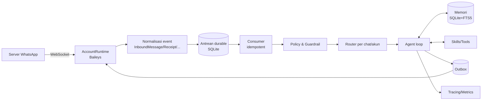

# Arsitektur Ibra X

Dokumen ini menjelaskan arsitektur, keputusan desain (ADR ringkas), dan alur sistem. Tujuannya agar kontributor memahami *mengapa*, bukan hanya *apa*.

---

## 1. Prinsip

1. **Baca, ingat, pahami, bertindak.** Agen mengamati lalu lintas WhatsApp, membangun memori, memahami maksud, lalu bertindak lewat skill — dengan izin yang ketat.
2. **Pisahkan transport dari kognisi.** Transport (Baileys) dinormalisasi menjadi event domain. Logika agen tidak boleh tahu detail protokol WhatsApp.
3. **Semua pesan masuk adalah data tak tepercaya.** Konten dari pengguna tidak pernah menjadi instruksi sistem.
4. **Izin default-deny, otoritas menyusut.** Setiap tool punya tingkat risiko; aksi berdampak butuh persetujuan.
5. **At-least-once + idempotensi.** Setiap pesan/aksi punya kunci idempotensi; konsumen toleran duplikat.
6. **Kegagalan punya taksonomi.** Retry ≠ rebuild ≠ escalate.
7. **Instalasi termudah.** Tanpa layanan eksternal wajib; state di SQLite; dijalankan dengan `tsx`.

---

## 2. Peta Paket

```
packages/
├── sdk/         Tipe inti + defineSkill/defineTool  (dipakai semua; dipublikasikan)
├── providers/   Adaptor LLM (engine OpenAI-compatible + preset)
├── core/        config, db, events, memory, session, policy, skills-loader, agent, runtime
├── whatsapp/    Transport Baileys: multi-akun, peran, antrean kirim, reconnect
├── server/      HTTP API + SSE
└── cli/         Perintah `ibrax`
skills/          Skill bawaan & contoh
```

Ketergantungan mengarah satu arah: `sdk ← providers ← core ← whatsapp/server/cli`.

---

## 3. Multi-Nomor dengan Peran

Satu proses dapat menjalankan **beberapa akun WhatsApp**, masing-masing satu `WASocket` (satu sesi auth). Setiap akun punya **peran**:

| Peran | Baca pesan | Bangun memori | Kirim pesan | Kasus pakai |
|---|---|---|---|---|
| `observer` | ✅ | ✅ | ❌ (kecuali notifikasi ke owner) | "Nomor untuk dibaca" — memantau grup/chat, merangkum, mengingat |
| `assistant` | ✅ | ✅ | ✅ (sesuai policy) | "Nomor untuk chat dengan AI" — membalas |
| `hybrid` | ✅ | ✅ | ✅ | Satu nomor untuk semua |

**Memori dibagi antar-akun.** Fakta tentang suatu kontak yang dipelajari oleh akun `observer` tersedia bagi akun `assistant`, sehingga satu nomor dapat mengamati dan nomor lain bertindak dengan pengetahuan yang sama.

> Catatan teknis penting: sesi Baileys adalah *perangkat pendamping* (companion) dari satu nomor ponsel. Ia melihat chat yang diikuti oleh nomor tersebut. Untuk "membaca seluruh lalu lintas", gunakan `observer` pada nomor utama Anda (sebagai companion), atau tambahkan nomor pengamat ke grup yang relevan. Ini keterbatasan protokol, bukan pilihan desain.

### Self-chat

Selain peran di atas, sebuah akun dapat mengaktifkan `selfChat`. Bila aktif, agen merespons
percakapan pemilik **ke nomornya sendiri** (self-chat) dengan otoritas owner penuh — berguna
sebagai catatan/komando pribadi. Untuk mencegah loop, ID setiap pesan yang dikirim bot dilacak:
gema pesan bot (`isEcho`) tidak pernah memicu agen, sedangkan pesan yang benar-benar diketik
pemilik di ponsel tetap diproses.

---

## 4. Alur Sistem



Tahapan:

1. **Ingest.** `messages.upsert` dinormalisasi menjadi `InboundMessage` (id, chat, pengirim + PN alternatif, teks/media).
2. **Antrean.** Ditulis ke antrean durable dengan kunci idempotensi = id pesan WhatsApp.
3. **Policy.** Allowlist pengirim, peran akun, mode (mention-only, quiet hours), deteksi risiko.
4. **Router.** Memilih sesi agen (per chat) dan agen yang tepat.
5. **Agent loop.** Bangun konteks, muat memori, panggil tool, batasi langkah/biaya.
6. **Outbox.** Aksi keluar ditulis ke outbox (transaksional), lalu dikirim lewat transport dengan serialisasi.
7. **Observability.** Setiap turn/step/tool menghasilkan trace.

---

## 5. Loop Agen

```
masukkan pesan -> muat sesi + memori -> pilih skill relevan
  loop sampai (selesai | batas langkah | anggaran habis):
    panggil model (streaming, dengan skema tool)
    jika tool_call:
      policy: izinkan? -> eksekusi -> simpan hasil (cache episodik)
               tolak/park? -> tandai butuh persetujuan
    jika jawaban teks: kirim
  setelah selesai: ringkas sesi (kompaksi) + tulis fakta memori
```

Batas: `maxSteps`, `maxTokensPerTurn`, dan anggaran biaya opsional. Saat batas tercapai, agen dipaksa merangkum (tidak memanggil tool lagi).

---

## 6. Memori

Tiga lapis:

1. **Sesi (jangka pendek).** Riwayat pesan per chat; dikompresi saat mendekati batas konteks (ringkasan + ekor verbatim).
2. **Memori fakta (jangka panjang).** Tabel `memory` dengan ruang lingkup (`global`/`contact`/`chat`), teks, tag, dan pencarian **FTS5**. Ditulis oleh agen lewat skill `memory`, atau otomatis setelah turn bermakna.
3. **Profil kontak.** Nama, preferensi, gaya bahasa, fakta penting.

Prinsip: memori bersifat **eksplisit dan dapat diaudit**. Setiap tulisan memori memiliki sumber (dari pesan mana). Pengguna dapat mencari dan menghapus.

---

## 7. Policy & Keamanan

- **Allowlist pengirim.** Kosong = mode owner-only.
- **Tingkat otonomi**: `readonly` (hanya mengamati & merangkum) → `suggest` (menyiapkan balasan untuk disetujui) → `auto` (membalas dalam allowlist) → `autonomous` (bertindak dengan izin).
- **Klasifikasi risiko per tool**: `low` (baca), `medium` (kirim pesan), `high` (hapus data, pindah dana, aksi ireversibel) → `high` selalu butuh persetujuan.
- **Isolasi kanal.** Konten pesan masuk disisipkan sebagai *data* (mis. dalam blok kutipan tepercaya-terbatas), bukan sebagai instruksi. Instruksi hanya berasal dari system prompt dan konfigurasi.
- **Egress.** Tool jaringan dibatasi; tidak ada kredensial di dalam loop agen.
- **Rate limit** per chat/pengirim untuk mencegah loop mahal dan pola spam.
- **Audit log** append-only: siapa memicu apa, tool apa, atas nama siapa.

---

## 8. Keandalan

Mengadopsi pelajaran dari protokol WhatsApp (lihat riset internal):

- **Antrean durable + idempotensi.** Pesan tidak hilang saat crash; dedup by id.
- **Serialisasi kirim.** Semua `sendMessage` per socket diserialisasi dalam satu antrean (kirim paralel dapat menyebabkan salah-antar). Ada timeout per panggilan.
- **Tangga pemulihan.** `retry` (backoff + jitter) → `rebuild` (buang state lokal, muat ringkasan kanonik) → `escalate` (park + tanya manusia).
- **Tugas terparkir.** Tugas yang butuh izin/manusia di-park (`INPUT_REQUIRED`) dan dilanjutkan otomatis saat izin diberikan.
- **Kebijakan reconnect.** Memetakan `DisconnectReason` → terminal (logged out) vs pulih (jaringan/restart), dengan backoff.

---

## 9. Skills & SDK

Sebuah skill adalah modul yang mengekspor `defineSkill({ id, tools, systemPrompt?, commands?, setup? })`. Tool memakai skema JSON (kompatibel MCP/OpenAI function calling):

```ts
import { defineSkill, defineTool } from "@ibrax/sdk"

export default defineSkill({
  id: "reminder",
  name: "Reminder",
  tools: [
    defineTool({
      name: "set_reminder",
      description: "Ingatkan pengguna pada waktu tertentu.",
      parameters: { type: "object", properties: { text: { type: "string" }, at: { type: "string" } }, required: ["text", "at"] },
      risk: "low",
      async execute({ text, at }, ctx) {
        return ctx.store.scheduleReminder({ text, at })
      },
    }),
  ],
})
```

Skill dimuat dari: (a) `skills/` bawaan, (b) paket npm bernama `ibra-skill-*`, (c) direktori yang dikonfigurasi, (d) server **MCP** (lewat `mcpServers`).

---

## 10. Keputusan Desain (ADR ringkas)

| # | Keputusan | Alasan | Konsekuensi |
|---|---|---|---|
| 1 | TypeScript/Node | Baileys adalah Node → satu bahasa | Tanpa jembatan proses; ekosistem npm luas |
| 2 | npm workspaces | Selalu tersedia | Tak perlu memasang pnpm |
| 3 | Tanpa build step (`tsx`) | Instalasi termudah | Perlu build saat publikasi npm (rencana) |
| 4 | Engine OpenAI-compatible | Mencakup mayoritas provider | Provider non-kompatibel butuh adaptor khusus |
| 5 | SQLite + FTS5 | Tanpa layanan eksternal | Skala besar butuh Postgres (rencana) |
| 6 | Peran akun (`observer`/`assistant`/`hybrid`) | Menjawab kebutuhan multi-nomor | Perlu koordinasi memori antar-akun |
| 7 | Konsep skill = tool MCP-compatible | Interoperabilitas | Bisa memakai server MCP yang ada |

---

## 11. Peta Jalan

- **Fase 1 (sekarang).** Fondasi: SDK, providers, core (policy, memori, agen), transport multi-akun, CLI, server.
- **Fase 2.** Media (transkripsi suara, deskripsi gambar), ringkasan grup harian, penjadwalan pesan, web search.
- **Fase 3.** Subagent & delegasi, memori bersama antar-nomor (konvergensi), dashboard web.
- **Fase 4.** Adaptor WhatsApp Cloud API resmi; dukungan Postgres; paket skill resmi.
